<p align="center">
  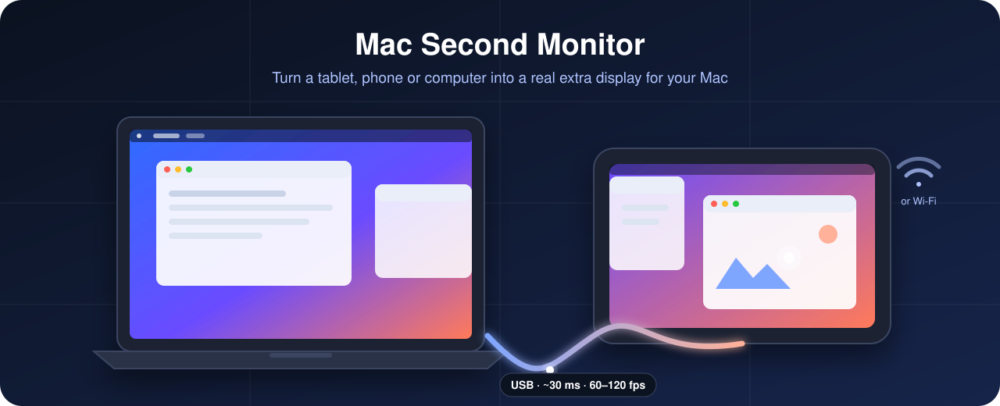
</p>

<p align="center">
  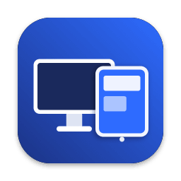
</p>

<h3 align="center">Turn any tablet, phone or computer into a real second display for your Mac.</h3>

<p align="center">
  <a href="#-quick-start">Quick start</a> ·
  <a href="#-step-by-step-setup">Step-by-step setup</a> ·
  <a href="#-using-your-new-display">Using it</a> ·
  <a href="#-troubleshooting">Troubleshooting</a> ·
  <a href="#-faq">FAQ</a> ·
  <a href="#-for-developers">Developers</a>
</p>

<p align="center">
  <a href="https://github.com/metekaganmusaak/mac-second-monitor/releases/latest"></a>
  
  
  
  
  
  
</p>

---

Mac Second Monitor gives your Mac **an extra screen made from a device you already own** — an
Android tablet, an iPad, a phone, or any computer with a browser. macOS sees it as a real monitor:
drag windows onto it, arrange it in System Settings, and touch, draw and type on it.

- 🖥️ **A real display, not screen sharing** — native resolution, Retina (HiDPI), 60 or 120 Hz.
- ⚡ **Fast** — about **30 ms** over a USB cable. Frames are never queued, so it stays responsive.
- 🔌 **Plug and play** — plug in an Android tablet and the display appears; iPhone and iPad work
  over USB too. Wi-Fi and browsers work without any cable.
- 👆 **Touch, pen and keyboard** — tap, drag, right-click, scroll with momentum, pressure-sensitive
  stylus, hardware and on-screen keyboards.
- 🔒 **Private** — everything stays on your cable or local network. New network devices pair once
  with a 6-digit code.
- 🌍 **12 languages** — English, Türkçe, Deutsch, Español, Français, Italiano, Português (Brasil),
  Русский, 简体中文, 日本語, 한국어, العربية.

<p align="center">
  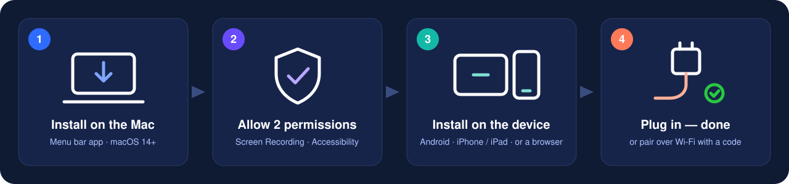
</p>

## 📋 What you need

| | Requirement |
| --- | --- |
| **Mac** | macOS 14 Sonoma or later. Apple Silicon recommended (hardware video encoder). |
| **Device** | An Android 8+ phone or tablet (including HUAWEI / Honor on HarmonyOS 2–4), an iPhone or iPad on iOS / iPadOS 16+, or any computer or device with a modern browser |
| **Connection** | A USB cable (best), or the same Wi-Fi network as the Mac |
| **For Android over USB** | Android platform tools on the Mac: `brew install android-platform-tools` |

## 🔀 Choose how to connect

<p align="center">
  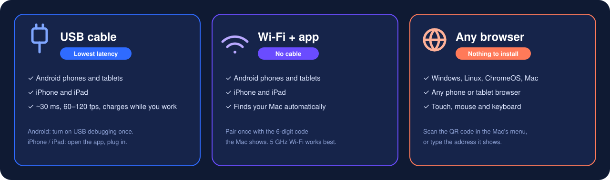
</p>

| Your device | USB cable | Wi-Fi | What you install on it |
| --- | :---: | :---: | --- |
| Android phone or tablet (Samsung, Pixel, Xiaomi, HUAWEI, Lenovo, …) | ✅ | ✅ | Android app |
| HUAWEI / Honor tablets on HarmonyOS 2–4 (e.g. MatePad 11) | ✅ | ✅ | Android app |
| iPad or iPhone | ✅ | ✅ | iOS app |
| Windows, Linux, ChromeOS or another Mac | — | ✅ | Nothing — open the browser client |
| HarmonyOS NEXT devices (can't install APKs) | — | ✅ | Nothing — open the browser client |

## 🚀 Quick start

> Already set up once? Then it's just: **open Mac Second Monitor on the Mac → plug in the
> device** (or open the app on it over Wi-Fi). The rest of this section is the first-time setup.

1. **Mac:** install and open **Mac Second Monitor** ([details](#step-1--install-the-mac-app)), then
   allow **Screen Recording** and **Accessibility** when asked.
2. **Device:** install the app ([Android](#android) · [iPhone / iPad](#iphone-and-ipad)), or skip
   this step if you use a [browser](#any-browser).
3. **Connect:** plug in the USB cable — on Android, turn on [USB debugging](#android) once first —
   or pick your Mac in the app over Wi-Fi and type the code the Mac shows.
4. **Arrange:** in *System Settings → Displays*, drag the new display next to your screen.

## 🧭 Step-by-step setup

### Step 1 — Install the Mac app

**Download:** grab `MacSecondMonitor-<version>.dmg` from the
[latest release](https://github.com/metekaganmusaak/mac-second-monitor/releases/latest), open it
and drag **Mac Second Monitor** into **Applications**.

> **First launch:** the app isn't notarized by Apple yet, so macOS asks whether to open it.
> Right-click the app → **Open** → **Open** (or *System Settings → Privacy & Security →
> Open Anyway*). You only have to do this once.

**Or build it yourself** (a few minutes, needs Xcode 16+):

```bash
git clone https://github.com/metekaganmusaak/mac-second-monitor.git
cd mac-second-monitor/mac
scripts/build-app.sh                  # creates "build/Mac Second Monitor.app"
cp -R "build/Mac Second Monitor.app" /Applications/
open "/Applications/Mac Second Monitor.app"
```

Mac Second Monitor lives in the **menu bar** (two overlapping rectangles); it has no Dock icon.
For Android over USB, also install the platform tools once:

```bash
brew install android-platform-tools
```

### Step 2 — Allow the two permissions

The welcome window walks you through both. They are only used locally:

| Permission | Why | Where |
| --- | --- | --- |
| **Screen Recording** | To capture the extra display and send it to your device | *System Settings → Privacy & Security → Screen Recording* |
| **Accessibility** | So touches, the pen and the keyboard on the device can control the Mac | *System Settings → Privacy & Security → Accessibility* |

<p align="center">
  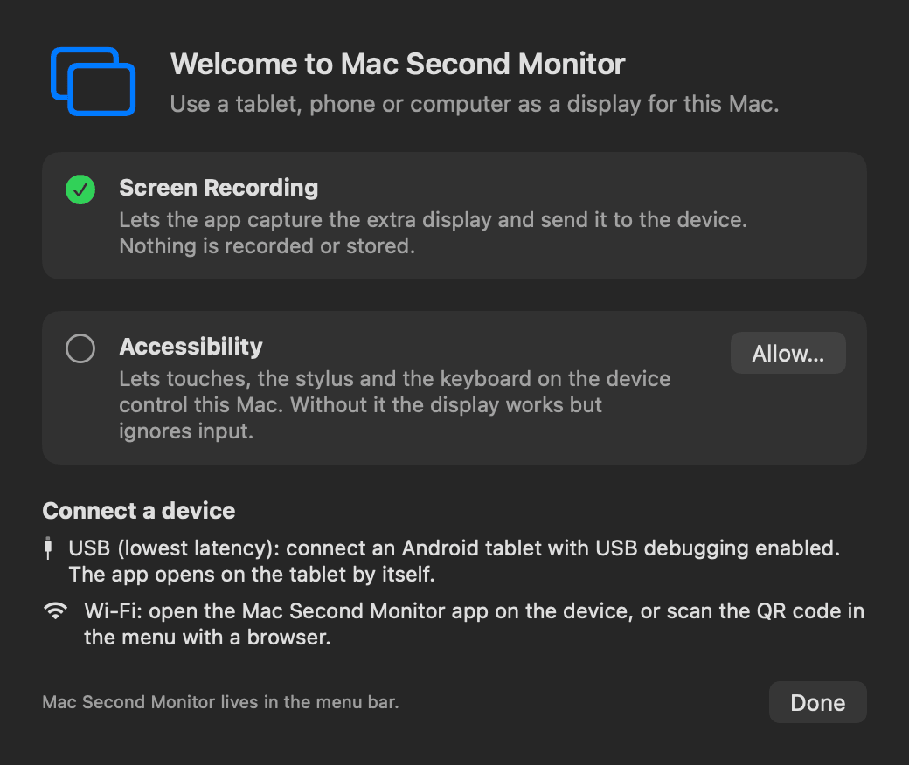
</p>

> Tip: start it automatically with *Mac Second Monitor → Settings → General → Open at login*.

### Step 3 — Set up your device

#### Android

**Install the app** — any one of these:

- On the Mac, once USB debugging is on (below), click **Install App** in the menu bar popover.
- Download `MacSecondMonitor-<version>.apk` from the
  [latest release](https://github.com/metekaganmusaak/mac-second-monitor/releases/latest) on the
  device, open it and allow *Install unknown apps* when asked.
- From a terminal: `adb install MacSecondMonitor.apk`.

**Turn on USB debugging** (only needed for the cable). It lets the Mac open a data tunnel to the
app — phones and tablets can't receive a video signal over USB-C:

<p align="center">
  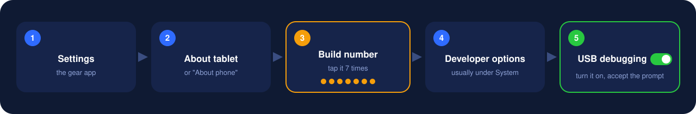
</p>

Where these settings are on popular brands:

| Brand | Tap *Build number* 7 times in… | Then turn on *USB debugging* in… |
| --- | --- | --- |
| Samsung (One UI) | Settings → About tablet/phone → Software information | Settings → Developer options |
| Google Pixel | Settings → About phone | Settings → System → Developer options |
| Xiaomi / Redmi / POCO | Settings → About phone → OS version (tap it 7×) | Settings → Additional settings → Developer options |
| HUAWEI / Honor (HarmonyOS, EMUI, MagicOS) | Settings → About tablet/phone → Build number | Settings → System & updates → Developer options — also turn on **Allow ADB debugging in charge only mode** |
| OnePlus / OPPO / realme | Settings → About device → Version → Build number | Settings → Additional settings → Developer options |
| Lenovo / Motorola | Settings → About tablet/phone → Build number | Settings → System → Developer options |

The first time you plug in, the device asks **Allow USB debugging?** — tick **Always allow from
this computer** and tap **Allow**.

#### iPhone and iPad

The iOS app isn't on the App Store yet. Build it with Xcode (a free Apple ID is enough; with a free
account you re-install every 7 days):

1. Open `ios/MacSecondMonitorClient.xcodeproj` in Xcode.
2. Select the *MacSecondMonitorClient* target → *Signing & Capabilities* → choose your team.
3. Connect the iPad / iPhone, select it as the run destination and press **Run**.

#### Any browser

Nothing to install. On the Mac, open the menu bar popover → **Connect from a browser** and scan the
QR code with the device, or type the address shown there (`http://<mac-ip>:7101/`). Works in
Chrome, Edge, Safari and Firefox. For full screen on iPhone / iPad, use *Share → Add to Home Screen*.

### Step 4 — Connect

**With a USB cable (lowest latency)**

1. Make sure Mac Second Monitor is running on the Mac.
2. Plug the device into the Mac.
   - **Android:** the Mac sets up the tunnel and opens the app on the device by itself — the
     display appears within a few seconds. No pairing needed.
   - **iPhone / iPad:** open the app; the Mac connects through the cable automatically.
3. Next time: just plug in.

**Over Wi-Fi**

1. Put the device on the same Wi-Fi network as the Mac (5 GHz works best).
2. Open the app. Your Mac appears under **On this network** — tap it. (Or type the Mac's IP
   address, shown in the menu bar popover.)
3. The Mac shows a **6-digit code** (in the popover and as a notification). Type it on the device.
   You only pair once per device.

<p align="center">
  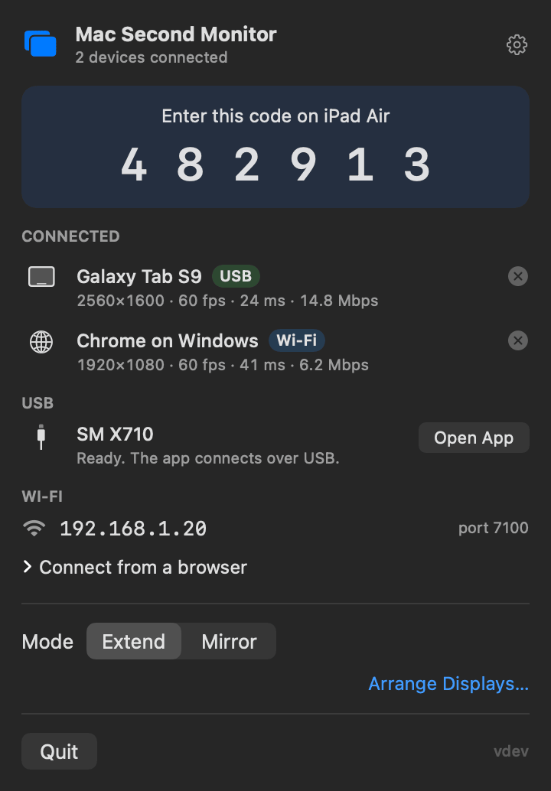
  &nbsp;&nbsp;
  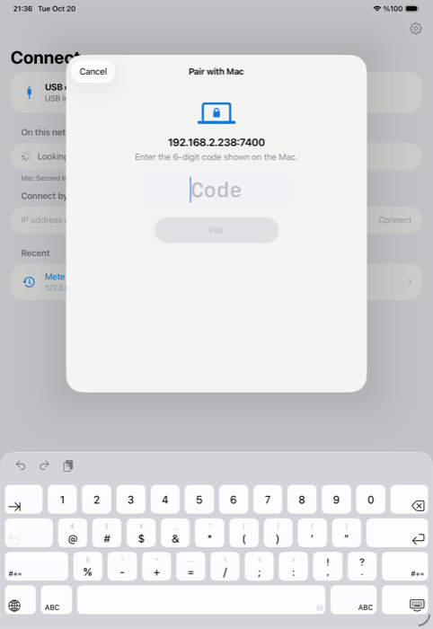
</p>

### Step 5 — Arrange the display

The device now shows up in **System Settings → Displays** like any monitor:

<p align="center">
  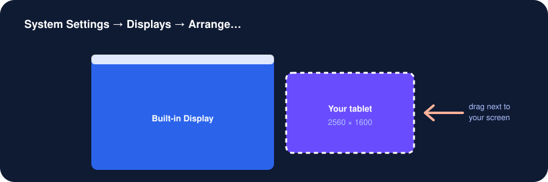
</p>

- **Arrange…** — drag it next to your screen so the pointer crosses over naturally. macOS remembers
  the position for each device.
- **Size** — pick a "looks like" size for more space or larger text. The picture stays at the
  device's native resolution.
- **Mirror instead of extend** — choose **Mirror** in the menu bar popover to show your main screen.

## ✋ Using your new display

<p align="center">
  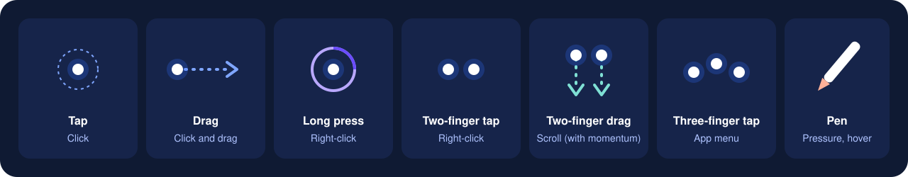
</p>

- **Menu on the device:** tap the small handle on the right edge (or tap with three fingers) for the
  on-screen keyboard, statistics and disconnect.
- **Keyboards:** Bluetooth or USB keyboards connected to the device type on the Mac. PC keyboard?
  Turn on *Use Ctrl as ⌘ Command* in the Android app's settings.
- **Prefer touch-screen scrolling?** Turn on *One finger scrolls* in the app's settings.
- **Statistics:** turn on *Show statistics* to see frame rate, latency and bitrate.

<p align="center">
  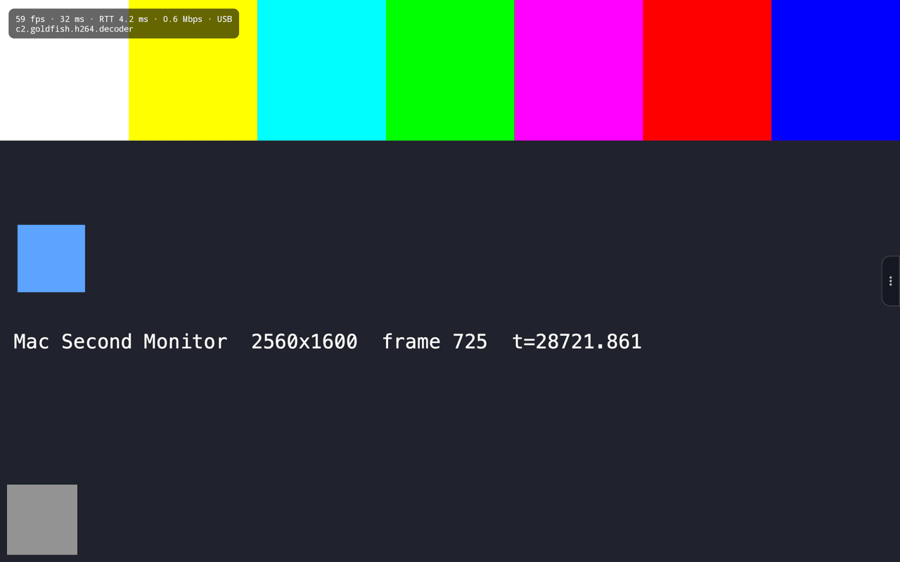
  &nbsp;
  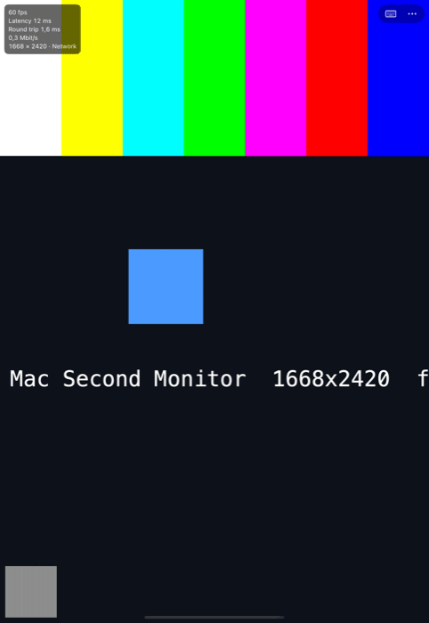
  &nbsp;
  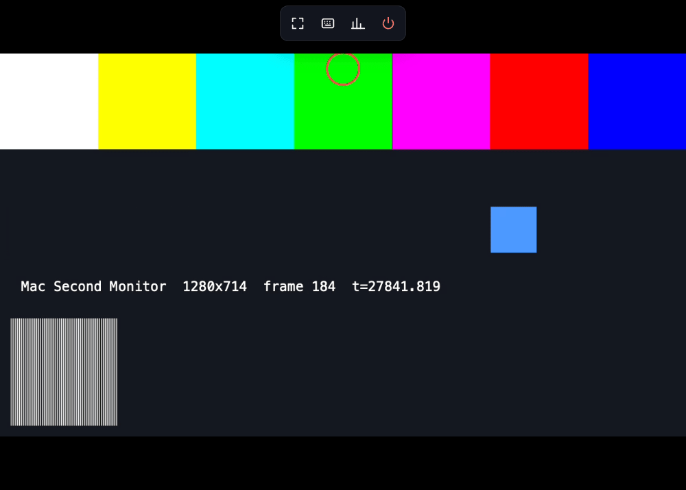
</p>
<p align="center"><sub>Android tablet over USB · iPad · browser client (shown with the built-in test pattern).</sub></p>

### Getting the lowest latency

<p align="center">
  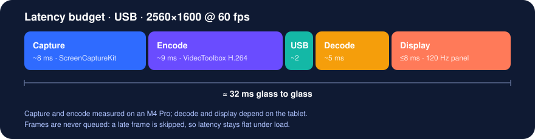
</p>

- **Use the cable.** USB avoids Wi-Fi interference and power saving.
- **120 Hz device?** Set *Mac Second Monitor → Settings → Video → Frame rate* to **120**.
- **On Wi-Fi:** use 5 GHz, stay close to the router, avoid busy guest networks.
- **Weak link?** *Settings → Video → Quality → Low* lowers the bitrate; the app also adapts
  automatically when the link backs up.

## 🔧 Troubleshooting

| Problem | Fix |
| --- | --- |
| The menu says *Android platform tools (adb) were not found* | `brew install android-platform-tools`, or set the adb path in *Settings → USB* |
| Android device shows **unauthorized** in the menu | Unlock it and accept *Allow USB debugging?*; if no prompt appears, replug the cable |
| Android asks for a pairing code over USB | Click **Open App** in the Mac's menu once (that hands the app its USB key), or type the code once |
| The display appears but stays black | Allow **Screen Recording** for Mac Second Monitor, then quit and reopen it |
| Touches don't do anything on the Mac | Allow **Accessibility** (after updating the app, remove it from the list and add it again) |
| The Mac isn't listed on the device over Wi-Fi | Same network? Guest networks often isolate devices — type the Mac's IP address instead |
| "Too many wrong codes" | Pairing pauses briefly after three wrong codes; wait the time shown and try again |
| iPad over USB doesn't connect | Keep the app open in the foreground; trust the Mac on the iPad if asked |
| Text looks soft | Pick the default "looks like" size in *System Settings → Displays*, or set *Quality → High* |

## ❓ FAQ

<details>
<summary><b>Is it really "zero latency"?</b></summary>

No streaming display can be literally zero — the image has to be captured, compressed, sent and
shown. Over USB it's about 30 ms, which feels immediate for normal work (a 60 Hz screen itself
redraws every 16.7 ms). Wi-Fi typically adds 10–30 ms.
</details>

<details>
<summary><b>Does anything go over the internet?</b></summary>

No. The stream goes directly from your Mac to your device over the cable or your local network.
There are no accounts and no servers.
</details>

<details>
<summary><b>Can I use several devices at once?</b></summary>

Yes. Each device becomes its own display, so you can have a tablet on the left and a phone on the
right.
</details>

<details>
<summary><b>Why does USB on Android need USB debugging?</b></summary>

Phones and tablets can't accept a video signal over USB-C (their ports only output video), so the
cable carries a data stream instead. ADB (Android's debugging bridge) is the most reliable way to
open a data channel to the app without installing drivers.
</details>

<details>
<summary><b>Does it work on HarmonyOS?</b></summary>

HarmonyOS 2–4 devices (such as the HUAWEI MatePad 11) run the Android app and work over USB and
Wi-Fi. HarmonyOS NEXT can't install Android apps; use the browser client over Wi-Fi there.
</details>

<details>
<summary><b>Is the stream encrypted?</b></summary>

Not yet (v1). Network devices must pair with a code before they can connect, and other websites
can't connect to the Mac. Use it on networks you trust; encryption is on the roadmap.
</details>

<details>
<summary><b>Will it drain my tablet's battery?</b></summary>

Over USB the device charges while you work. Decoding uses the device's hardware video decoder, so
power use is similar to watching a video.
</details>

## 👩‍💻 For developers

```text
mac/        macOS host (Swift package): menu bar app, msm CLI, shared protocol + client libraries
android/    Android / HarmonyOS client (Kotlin)
ios/        iOS / iPadOS client (SwiftUI)
web/        Browser client (TypeScript), served by the Mac
docs/       Architecture, wire protocol, roadmap
```

| Component | Docs | Build | Test |
| --- | --- | --- | --- |
| macOS host | [mac/README.md](mac/README.md) | `swift build` / `scripts/build-app.sh` | `swift test` |
| Android | [android/README.md](android/README.md) | `./gradlew assembleDebug` | `./gradlew testDebugUnitTest` |
| iOS | [ios/README.md](ios/README.md) | Xcode / `xcodebuild` | — |
| Web | [web/README.md](web/README.md) | `npm run build` | `npm test` |

How it works, in one picture:

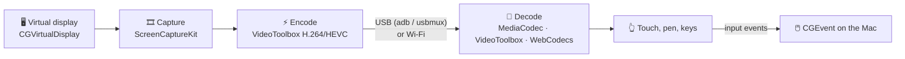

The Mac keeps at most two unacknowledged frames in flight and always sends the newest one, so
latency stays flat when the link or the device falls behind. Details:
[ARCHITECTURE.md](docs/ARCHITECTURE.md) · wire format: [PROTOCOL.md](docs/PROTOCOL.md) · plan and
status: [ROADMAP.md](docs/ROADMAP.md).

No device at hand? `swift run msm serve --test-pattern` streams a synthetic image and
`swift run msm probe` is a complete test client that reports fps and latency.

### Project status

Every phase of the [roadmap](docs/ROADMAP.md) has a working implementation. Verified so far: the
full host pipeline on macOS 26 (real virtual-display capture), the Android app over the USB tunnel
in the emulator at tablet resolution (2560×1600), the iOS app in the iPad and iPhone simulators
(H.264 and HEVC), and the browser client in Chrome. **Not yet verified on physical devices** —
reports and pull requests are very welcome.

### What's new

See the [changelog](CHANGELOG.md).

## 🤝 Contributing

See [CONTRIBUTING.md](CONTRIBUTING.md). Translations are welcome too — adding a language is a
translation-only change.

## 📄 License

To be decided.
