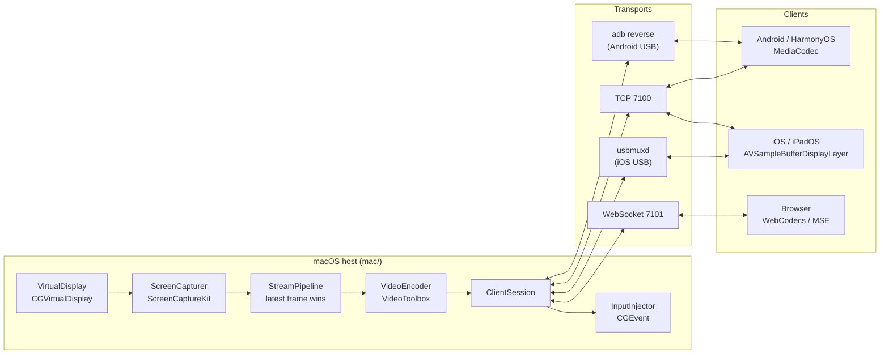

# Architecture

## Overview

One **session** per connected client. Each session owns its virtual display, capture stream and
encoder, so several devices can be used at once, each as its own display.

## Design rules

- **Latency over completeness.** A late frame is skipped, never queued. The host keeps at most
  two unacknowledged frames in flight; while that window is full it replaces the pending capture
  with the newest one (`StreamPipeline`). Clients decode and show frames on arrival and render
  only the newest decoded frame.
- **No B-frames**, keyframes only at the start and on request. Every frame can be shown as soon as
  it is decoded.
- **Coordinates are normalized** (0–1 of the video frame), so input is independent of scaling and
  letterboxing.
- **One protocol on every transport**: the same framed messages over TCP, ADB / usbmux tunnels and
  WebSocket. See [PROTOCOL.md](PROTOCOL.md).
- **USB is trusted, the network pairs.** USB clients skip pairing (iOS: the Mac dials the device;
  Android: the app proves itself with a secret the Mac passes through adb). Everything else,
  including other local processes and browsers, pairs once with a 6-digit code.

## macOS host (`mac/`)

| Module | File(s) | Responsibility |
| --- | --- | --- |
| `VirtualDisplay` | `Display/VirtualDisplay.swift`, `CGVirtualDisplayKit` | Creates a `CGVirtualDisplay` with the client's pixel size, physical size (from DPI) and a serial derived from the device ID, so macOS remembers the arrangement per device. Offers HiDPI modes at 0.8×–1.5× of the native "looks like" size. |
| `ScreenCapturer` | `Capture/ScreenCapturer.swift` | `SCStream` on the virtual display (extend) or the main display (mirror, aspect-fit), NV12 at the client's resolution, only changed frames. |
| `TestPatternSource` | `Capture/TestPatternSource.swift` | Synthetic frames for tests and development (no permissions needed). |
| `VideoEncoder` | `Encode/VideoEncoder.swift`, `AnnexB.swift` | `VTCompressionSession`: hardware only, real-time, no reordering, low-latency rate control (H.264), forced keyframes; converts output to Annex-B with in-band parameter sets and builds RFC 6381 codec strings. |
| `StreamPipeline` | `Session/StreamPipeline.swift` | Capture → encode → send for one client, ACK-window flow control, per-second stats, `AdaptiveBitrate`. |
| `ClientSession` | `Session/ClientSession.swift` | HELLO, pairing, WELCOME, starting the pipeline, input routing, PING / STATS, 10 s timeout. |
| `HostEngine` | `Host/HostEngine.swift` | Listeners, sessions, trust store; one device ⇒ one session (a reconnect replaces the stale one). |
| Transports | `Net/*.swift` | `TCPMessageChannel` (Network.framework, `TCP_NODELAY`, interactive-video service class), `WebServer` (static files + WebSocket upgrade on one port), `WebSocketMessageChannel` (RFC 6455), Bonjour `_macsecondmon._tcp`. |
| `AdbBridge` | `USB/AdbBridge.swift` | Tracks devices through the ADB server socket, runs `adb reverse tcp:7100 tcp:7100`, checks / installs / launches the Android app. |
| `UsbmuxBridge` | `USB/UsbmuxBridge.swift` | Listens to `usbmuxd`, connects to port 7100 on attached iOS devices and adopts the tunnel as a session. |
| `InputInjector` | `Input/*.swift` | Maps normalized input to the display, posts mouse (with click counting), trackpad-style scroll phases, HID-usage keys and Unicode text as `CGEvent`s. |
| `TrustStore` | `Pairing/TrustStore.swift` | Paired devices with SHA-256 token hashes in `~/Library/Application Support/MacSecondMonitor`. |
| App | `Sources/MacSecondMonitor` | SwiftUI `MenuBarExtra`, settings, onboarding, pairing notifications, QR code. |

### Threading

- Every `ClientSession` has a serial queue; its pipeline and input injector run on it.
- Capture callbacks (ScreenCaptureKit queue) and encoder callbacks (VideoToolbox threads) hop onto
  the session queue.
- `HostEngine` notifies the UI asynchronously and coalesced; the UI reads snapshots.

### Requirements

macOS 14+, Screen Recording and Accessibility permissions. `CGVirtualDisplay` is a private API, so
the app is distributed outside the Mac App Store.

## Clients

| Client | Transport | Decode → render | Input |
| --- | --- | --- | --- |
| Android (`android/`) | TCP; USB via `adb reverse` | `MediaCodec` (low-latency + vendor keys) → `SurfaceView` | `GestureMachine` (touch), stylus, mouse, hardware and soft keyboard |
| iOS / iPadOS (`ios/`) | TCP; USB via usbmux (the app listens) | `AVSampleBufferDisplayLayer` | Touch, Apple Pencil, trackpad / mouse, hardware and soft keyboard |
| Web (`web/`) | WebSocket | WebCodecs → canvas; MSE (fragmented MP4) fallback on plain HTTP | Pointer events, keyboard, soft keyboard |

All clients send `ACK` for every frame, `PING` every second and `STATS` every second, and estimate
capture-to-display latency from the PING/PONG clock offset.

## Localization

Every app ships with 12 languages: English (base), Turkish, German, Spanish, French, Italian,
Brazilian Portuguese, Russian, Simplified Chinese, Japanese, Korean and Arabic (right-to-left).
Rules:

1. No user-facing string literals in code; always go through the platform's localization API.
2. String keys are English, dot-separated and stable (e.g. `permission.screenRecording.title`).
3. Plurals and formatting use the platform's native mechanisms.
4. Each app follows the system language by default and offers a manual language override.

| Platform | Mechanism | Location |
| --- | --- | --- |
| macOS | String Catalog, read through `L10n` | `mac/Sources/MSMHost/Resources/Localizable.xcstrings` |
| iOS | String Catalog | `ios/MacSecondMonitorClient/Resources/Localizable.xcstrings` |
| Android | Resources | `android/app/src/main/res/values/strings.xml`, `values-tr/strings.xml` |
| Web | JSON catalogs | `web/src/i18n/en.json`, `tr.json` |

Adding a language means adding translations to these files; no code changes.
