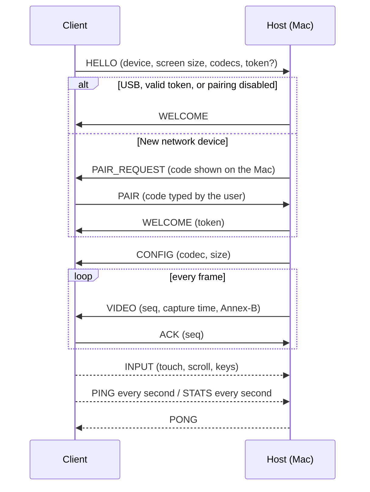

# Wire protocol (v1)

This is the contract between the macOS host and every client. The reference implementations are
[`mac/Sources/MSMProtocol`](../mac/Sources/MSMProtocol) (Swift) and the Android / web clients.

## Transports and ports

| Transport | Client | How it connects |
| --- | --- | --- |
| TCP `7100` | Native clients over Wi-Fi / Ethernet | Client → host |
| TCP `7100` via `adb reverse` | Android over USB | Client → `127.0.0.1:7100` on the device, tunnelled to the host by ADB |
| TCP `7100` via usbmux | iOS / iPadOS over USB | **Host → client**: the app listens on `7100` on the device, the host connects through `usbmuxd`. Protocol roles stay the same: the client still sends `HELLO` first. |
| HTTP + WebSocket `7101` | Web client | `GET /` serves the client, `GET /ws` upgrades to WebSocket |

Discovery: the host advertises Bonjour service `_macsecondmon._tcp` on the native port with TXT
records `v=1` (protocol version) and `web=7101`.

Who may skip pairing (everyone else pairs once with a code):

- **iOS over USB:** connections the host opens itself through usbmux go to the device on the cable.
- **Android over USB:** connections through the `adb reverse` tunnel arrive on the host's loopback
  interface, but any app on the device can dial 127.0.0.1. When the host launches the app over ADB
  it passes a secret (`am start --es com.macsecondmonitor.client.extra.SECRET <secret>`); the app
  sends it as `token` in HELLO. Loopback connections without it pair like network clients.
- **Paired devices:** a valid token from an earlier WELCOME.

## Framing

Every message has a 6-byte header followed by the payload. All integers are big-endian, floats are
IEEE-754 binary32 big-endian.

```
 0        1        2                                  6
 +--------+--------+----------------------------------+------------------+
 |  type  | flags  |       payload length (u32)       |  payload ...     |
 +--------+--------+----------------------------------+------------------+
```

- Maximum payload: 16 MiB. A receiver closes the connection on larger lengths.
- On TCP, messages are written back to back.
- On WebSocket, each **binary** WebSocket message carries exactly one protocol message, header
  included.
- Receivers **skip unknown message types** (forward compatibility).

## Message types

| Type | Name | Direction | Payload |
| --- | --- | --- | --- |
| `0x01` | `HELLO` | C → H | JSON |
| `0x02` | `WELCOME` | H → C | JSON |
| `0x03` | `PAIR_REQUEST` | H → C | JSON |
| `0x04` | `PAIR` | C → H | JSON |
| `0x05` | `ERROR` | H → C | JSON, then the host closes |
| `0x10` | `CONFIG` | H → C | JSON |
| `0x11` | `VIDEO` | H → C | binary |
| `0x12` | `KEYFRAME_REQ` | C → H | empty |
| `0x13` | `ACK` | C → H | binary |
| `0x20` | `INPUT` | C → H | binary |
| `0x30` | `PING` | both | binary |
| `0x31` | `PONG` | both | binary |
| `0x32` | `STATS` | C → H | JSON |
| `0x7F` | `BYE` | both | JSON |

## Session flow



### HELLO (client → host)

```json
{
  "protocol": 1,
  "deviceId": "6f1c…",            // stable random ID, generated once per install
  "deviceName": "HUAWEI MatePad 11",
  "platform": "android",         // android | ios | web | macos
  "appVersion": "0.1.0",
  "display": { "width": 2560, "height": 1600, "dpi": 276, "refreshRate": 120 },
  "codecs": ["h264", "hevc"],    // decodable codecs, in order of preference
  "locale": "tr-TR",
  "token": "…"                   // optional, from an earlier WELCOME
}
```

- `display.width` / `height`: pixels of the view that shows the stream, in the orientation it will
  be shown. The host creates a virtual display with exactly this backing size.
- `dpi`: physical pixels per inch (0 if unknown); macOS uses it to pick the default scale.
- `refreshRate`: the host streams at `min(host fps setting, refreshRate)`, at least 30.

### WELCOME (host → client)

```json
{ "protocol": 1, "hostName": "Mete's MacBook Pro", "sessionId": "…", "transport": "usb", "token": "…" }
```

`token` is present only right after pairing. Clients store it per host and send it in later HELLOs.

### PAIR_REQUEST / PAIR

```json
{ "codeLength": 6, "attemptsLeft": 3, "retry": false }   // PAIR_REQUEST
{ "code": "123456" }                                    // PAIR
```

The code is shown on the Mac and expires after 120 s. After three wrong codes the host sends
`ERROR pairing_failed`.

### ERROR

```json
{ "code": "permission_missing", "message": "Screen Recording permission is required…" }
```

| Code | Meaning |
| --- | --- |
| `unsupported_protocol` | Protocol version mismatch |
| `pairing_failed` / `pairing_timeout` | Pairing did not complete |
| `pairing_unavailable` | Another device is pairing, or pairing is paused after wrong codes (the message says for how long) |
| `rejected` | Invalid HELLO (e.g. impossible resolution) |
| `permission_missing` | The Mac lacks Screen Recording permission |
| `display_unavailable` | The virtual display or capture could not start |
| `internal` | Anything else |

`message` is localized by the host for display; clients should show their own text for known codes.

### CONFIG (host → client)

```json
{ "codec": "h264", "codecString": "avc1.640C33", "width": 2560, "height": 1600, "fps": 60, "mode": "extend" }
```

Sent before the first `VIDEO` frame and again whenever the stream parameters change. `codecString`
is an RFC 6381 string (used by WebCodecs).

### VIDEO (host → client)

```
 u32  seq           increments by 1 per frame
 u64  captureTime   µs, host monotonic clock
 ...  data          one access unit, Annex-B (00 00 00 01 start codes)
```

- Header flag bit 0 (`0x01`) marks a keyframe. Keyframes start with the parameter sets
  (H.264: SPS, PPS; HEVC: VPS, SPS, PPS).
- The stream has **no B-frames**: every frame can be decoded and shown as soon as it arrives.
- The host only sends a keyframe at the start and on `KEYFRAME_REQ`. A static screen produces no
  frames at all; clients keep showing the last one.

### ACK (client → host) — required

```
 u32  seq
```

Send it as soon as the frame has been handed to the decoder. The host keeps **at most 2
unacknowledged frames** in flight; while that window is full it skips captures and later encodes the
newest one. This bounds queueing anywhere on the path (Wi-Fi, ADB, socket buffers) so latency stays
low. A client that never acknowledges receives only two frames.

A client may hold back an ACK while its own decoder queue is full (and release it as the decoder
catches up, or after a short timeout such as 250 ms). This lets a slow decoder throttle the host
instead of building a queue on the device.

### KEYFRAME_REQ (client → host)

Empty. Send it after a decoder error, a decoder reset (e.g. the app returned from the background),
or when a frame arrives before any keyframe.

### INPUT (client → host)

Coordinates are normalized to the video frame: `(0, 0)` is the top-left pixel, `(1, 1)` the
bottom-right. The host maps them to the display (accounting for letterboxing in mirror mode).

First byte is the event kind:

**`0x01` POINTER** (17 bytes)

```
 u8   kind = 0x01
 u8   action     0 move · 1 down · 2 up · 3 cancel
 u8   button     0 left · 1 right · 2 middle    (ignored for move)
 u8   tool       0 mouse · 1 finger · 2 stylus
 u8   reserved   0
 f32  x
 f32  y
 f32  pressure   0…1 (1 if unknown)
```

Moves while a button is down become drags. The host counts double / triple clicks itself.

**`0x02` SCROLL** (21 bytes)

```
 u8   kind = 0x02
 u8   phase      0 none (wheel step) · 1 began · 2 changed · 3 ended · 4 momentum · 5 momentum ended
 u8   unit       0 normalized (fraction of frame width / height) · 1 lines
 u16  reserved   0
 f32  x, y       pointer position (normalized)
 f32  dx, dy     positive dy = content moves down (finger moved down), like a touch screen
```

Phases let macOS treat the gesture like a trackpad (smooth scrolling, rubber-banding, momentum).

**`0x03` KEY** (7 bytes)

```
 u8   kind = 0x03
 u8   action     1 down · 2 up
 u8   reserved   0
 u16  usage      USB HID Keyboard/Keypad page (0x07) usage ID, e.g. 0x04 = A, 0x28 = Return
 u16  modifiers  bit 0 shift · 1 control · 2 option/alt · 3 command/meta · 4 caps lock · 5 fn
```

HID usages describe physical key positions; the Mac's active input source produces the character.
`modifiers` is the state *after* this event.

**`0x04` TEXT**

```
 u8   kind = 0x04
 ...  UTF-8 text
```

For soft keyboards and input methods: committed text is typed as-is, independent of layouts.
Send Backspace / Return / arrows as `KEY` events.

#### Recommended touch mapping

| Gesture | Send |
| --- | --- |
| Tap | POINTER move + down + up (left) |
| Drag | POINTER down, moves, up (left) — start after the touch slop |
| Long press (~500 ms, no movement) | right click |
| Two-finger tap | right click |
| Two-finger drag | SCROLL began / changed / ended (+ momentum after a fling) |
| Stylus | POINTER with `tool = stylus`, down immediately (no slop); hover = move |

### PING / PONG

```
 PING: u64 time               sender's clock, µs
 PONG: u64 echoedTime, u64 responderTime
```

Clients send `PING` every second. The host closes connections that are silent for 10 s.

From a `PONG`, a client computes `rtt = now − echoedTime` and the host clock offset
`offset = responderTime − (echoedTime + rtt / 2)` (use the sample with the lowest RTT). Then
`latency ≈ now + offset − captureTime` for each displayed frame.

### STATS (client → host)

```json
{ "fps": 59.8, "decodeMs": 3.1, "latencyMs": 28.4, "rttMs": 1.2, "droppedFrames": 0, "bitrateKbps": 9500 }
```

About once per second. Shown in the host UI and used for adaptive bitrate.

### BYE

```json
{ "reason": "user" }   // user | shutdown | replaced
```

`replaced` means the same device opened a newer connection.

## Security notes

- Network clients must pair once (6-digit code shown on the Mac, 3 attempts, 120 s). Only a
  SHA-256 hash of the token is stored on the host.
- Only one device can pair at a time, and three wrong codes pause pairing for everyone (30 s,
  60 s, 120 s … up to 10 minutes), so the code can't be brute-forced.
- The WebSocket endpoint only accepts an `Origin` equal to the page's own address, so other
  websites open on a device can't connect. Loopback WebSockets are not treated as USB.
- USB clients skip pairing as described under [Transports and ports](#transports-and-ports).
- v1 does not encrypt the stream; use it on networks you trust. TLS is planned.
